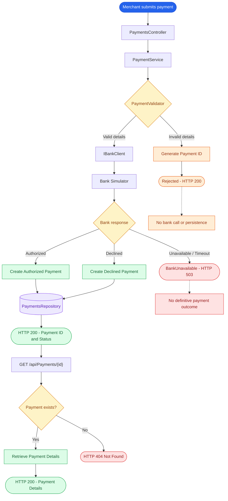
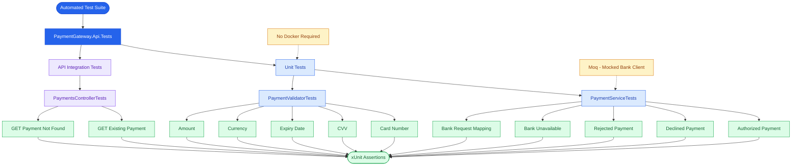

# Payment Gateway API

## Overview

A lightweight payment gateway API built using ASP.NET Core and C#.

The application provides an API for merchants to submit payment requests, validates payment details, communicates with an external bank simulator to obtain authorization decisions, and allows merchants to retrieve previously processed payments.

The gateway supports the following payment outcomes:

- **Authorized:** The payment was authorized by the acquiring bank.
- **Declined:** The payment was declined by the acquiring bank.
- **Rejected:** The payment gateway rejected the request because invalid information was supplied. The acquiring bank is not contacted and no payment record is created.

The implementation focuses on:

- Clear separation of responsibilities.
- Secure handling of sensitive payment information.
- Reliable communication with the bank simulator.
- Input validation before bank authorization.
- Consistent API responses and error handling.

## Architecture

The application follows a layered approach, keeping HTTP concerns, payment processing logic, validation, external bank communication and data storage separate.

### Component Responsibilities

| Component | Responsibility |
|---|---|
| `PaymentsController` | Exposes payment API endpoints and translates processing outcomes into HTTP responses. |
| `PaymentService` | Orchestrates the payment lifecycle, including validation, bank authorization and persistence. |
| `PaymentValidator` | Validates payment details before any bank communication takes place. |
| `IBankClient` | Defines the contract for communicating with an external bank. |
| `BankSimulatorClient` | Implements the bank integration using HTTP and handles communication failures. |
| `PaymentsRepository` | Stores and retrieves payment records using an in-memory concurrent dictionary. |

### Payment Gateway Architecture & Flow

The following diagram illustrates the complete payment lifecycle, from merchant submission through bank authorization and payment retrieval.



## Testing Strategy & Coverage

The solution uses xUnit and Moq to test payment-processing logic independently of external dependencies. API integration tests use `WebApplicationFactory` to verify endpoint behaviour.




### Design Considerations

- Payment validation takes place before communicating with the bank.
- Invalid payment requests return a Rejected outcome without calling the bank or creating a payment record.
- Both authorized and declined payments are persisted.
- Bank declines are treated as valid business outcomes rather than technical failures.
- Only the last four digits of the card number are retained.
- CVV and full card numbers are not persisted.
- Bank communication is abstracted behind `IBankClient`, allowing the bank integration to be replaced independently of the payment-processing logic.
- The repository is shared across requests using a singleton lifetime.


## Prerequisites

Before running the application, ensure you have the following installed:

- [.NET 8 SDK](https://dotnet.microsoft.com/download/dotnet/8.0)z
- [Docker Desktop](https://www.docker.com/products/docker-desktop/)
- Git

## Running Locally

The solution consists of two components:

1. Bank Simulator, running inside Docker using Docker Compose.
2. Payment Gateway API, running locally using the .NET CLI.

### 1. Start the Bank Simulator

Clone the repository:

```bash
git clone https://github.com/cko-recruitment/payment-gateway-challenge-dotnet.git
cd payment-gateway-challenge-dotnet
```

Start the bank simulator using Docker Compose:

```bash
docker compose up -d
```

The bank simulator should be accessible at:

```text
http://localhost:8080
```

### 2. Configure the Payment Gateway

Check `appsettings.json` and ensure the bank simulator URL is configured:

```json
{
  "BankSimulator": {
    "BaseUrl": "http://localhost:8080"
  }
}
```

### 3. Run the Payment Gateway API

From the repository root, run:

```bash
dotnet run --project PaymentGateway.Api
```

The API will start locally. Check the console output for the actual listening URL.

### 4. Access Swagger

Once the API is running, access the Swagger UI at:

[https://localhost:7092/swagger/index.html](https://localhost:7092/swagger/index.html)

Use Swagger to submit payment requests and retrieve payment details.

### 5. Stop the Bank Simulator

When finished, stop the Docker containers:

```bash
docker compose down
```

## API Response Behaviour

The payment API returns the following outcomes:

| Scenario | HTTP Status | Payment Status | Persisted |
|---|---:|---|---|
| Bank authorizes payment | 200 OK | Authorized (0) | Yes |
| Bank declines payment | 200 OK | Declined (1) | Yes |
| Gateway rejects invalid payment details | 200 OK | Rejected (2) | No |
| Bank unavailable or request times out | 503 Service Unavailable | No definitive outcome | No |
| Malformed JSON or model-binding failure | 400 Bad Request | No payment outcome | No |

### Example POST Response

A successful or rejected payment returns:

```json
{
  "id": "Auto-Generated-GUID",
  "status": 2
}
```

## Testing

The solution includes automated unit tests and API integration tests using xUnit.

### Unit Tests

Unit tests cover the core payment-processing and validation logic.

**PaymentServiceTests**
- Authorized payment processing and persistence.
- Declined payment processing and persistence.
- Rejected payment handling without contacting the bank or persisting a payment.
- Bank unavailable scenarios.
- Verification of payment details sent to the bank simulator.

**PaymentValidatorTests**
- Valid and invalid card numbers.
- Valid and invalid CVV values.
- Expiry date validation.
- Supported and unsupported currencies.
- Positive, zero and negative payment amounts.

### Integration Tests

API integration tests use `WebApplicationFactory` to verify HTTP endpoint behaviour, including:
- Retrieving an existing payment successfully.
- Returning HTTP 404 when a payment cannot be found.

### Running Tests

Run all automated tests from the solution directory:

```bash
dotnet test
```


## Design Decisions

### Payment Processing

- Payment validation is performed before any communication with the bank.
- Invalid payment requests are returned with a Rejected status and a generated payment ID. Rejected requests are not persisted.
- The bank's authorization decision determines whether a payment is Authorized or Declined.
- Both Authorized and Declined payments are persisted and can subsequently be retrieved.
- A bank decline is treated as a valid business outcome, not a technical failure.
- Bank communication failures and timeouts are handled separately from payment outcomes and return HTTP 503.
- Automatic retries are not performed for payment authorization requests because a timeout may occur after the bank has already processed the payment.
- Malformed JSON and request model-binding errors are handled by ASP.NET Core and return HTTP 400.

### Data Handling

- Full card numbers and CVVs are used only during payment processing.
- Only the last four card digits are retained for payment retrieval.
- The repository uses `ConcurrentDictionary` to support concurrent access to payment records.

### Bank Integration

- Bank communication is abstracted behind `IBankClient`.
- The bank simulator implementation uses `HttpClient` through `IHttpClientFactory`.
- The bank simulator URL is configurable through application settings.
- HTTP communication failures and unexpected bank responses are handled without exposing internal details to API consumers.

## Known Limitations and Future Improvements

The current implementation focuses on demonstrating the core payment lifecycle within the scope and time constraints of the challenge.

Potential future improvements include:

- **Persistent storage:** Replace the in-memory repository with a database to retain payment records across application restarts and support multiple application instances.
- **Idempotency:** Introduce idempotency keys to protect against duplicate payment submissions and support safe recovery from uncertain bank outcomes.
- **Observability:** Extend structured logging with correlation identifiers, metrics and distributed tracing.
- **Production security:** Integrate with a PCI DSS-compliant card-data handling and tokenisation solution rather than retaining raw card details in application memory.
- **Resilience:** Introduce reconciliation mechanisms to investigate payment outcomes when bank communication fails or times out.

## Development Scope and Time Constraints

The solution was developed within the allocated time for the technical challenge. The primary focus was to deliver a working payment gateway with a clear architecture, core payment processing functionality, automated tests and appropriate handling of success and failure scenarios.

Given additional development time, I would have extended the implementation in the following areas:

- **Resilience and recovery:** Introduce idempotency keys and payment reconciliation to handle uncertain outcomes caused by bank timeouts or communication failures.
- **Persistent storage:** Replace the in-memory repository with a database to support data persistence across application restarts and multiple application instances.
- **Enhanced observability:** Extend structured logging with correlation IDs, application metrics and distributed tracing.
- **Deployment and hosting:** Extend the existing Docker Compose setup to include the Payment Gateway API, allowing the complete solution to be started and managed as a single environment.
- **API enhancements:** Introduce consistent structured error responses, additional API documentation and more detailed validation feedback for merchants.
- **Webhook notifications:** Introduce an asynchronous webhook mechanism to notify merchants when a payment reaches a final status, such as Authorized or Declined. This would include secure webhook signing, retry handling for failed deliveries, delivery tracking and idempotent event processing.

These improvements represent potential next steps rather than functionality currently included in the submission.


